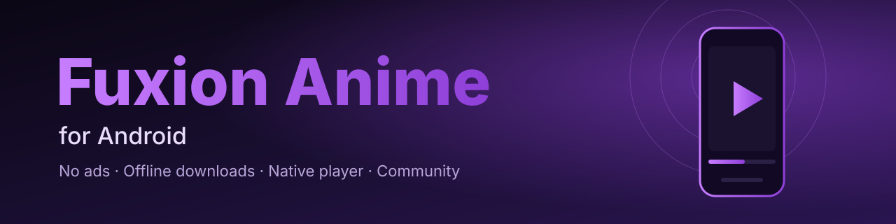

 

### A fast, beautiful, completely ad-free anime client for Android
### Быстрый, красивый и полностью безрекламный клиент для просмотра аниме на Android

 

 

**🌐 &nbsp;[English](#en) &nbsp;·&nbsp; [Русский](#ru)**

 

# 🇬🇧 English

> **Fuxion Anime for Android** is a native phone app for watching anime: a rich catalog, a built-in Media3 (ExoPlayer) player with touch controls, offline downloads and a real community, with **no ads** and a **fair, cosmetic-focused subscription**.

> [!NOTE]
> This repository hosts **releases and documentation only**. The application is proprietary, closed-source software by **Fuxion Labs** (see [LICENSE](LICENSE)). It is also available for Windows: [Fuxion Anime for Windows](https://github.com/Fuxion-labs/Fuxion-Anime-Win-Public).

## ✨ Highlights

| | |
|---|---|
| 🚫 **Zero ads** | No banners, no pop-ups, no trackers, no injected video ads. |
| 💎 **Honest subscription** | Premium is **cosmetics and profile customization**. Nothing is locked: every title, episode and quality is available to everyone. Subscribers additionally get a convenience: one-tap download of a whole series. |
| 🎬 **Touch-first player** | Built-in **Media3 / ExoPlayer** player: tap for controls, **double-tap to seek ±10 s**, fullscreen with automatic rotation, quality selector, skip intros, resume where you stopped. |
| 📥 **Offline mode** | Background downloads (**MP4** and **HLS**) with a queue, progress, a notification and offline playback. Downloads are grouped **per anime** so you see which episodes are ready. |
| 🌍 **Two catalogs** | Separate **Russian** and **English** experiences: RU/EN interface, catalog and voice-overs by language. |
| 👥 **Real community** | Friends, private chats, threaded comments, reviews, bookmarks and profiles. |
| 🔄 **Over-the-air updates** | New versions arrive inside the app: checked with SHA-256, then handed to the Android installer. |
| 🎨 **Dark neon design** | Smooth page transitions, animated frames, backgrounds and nickname styles. |

## 📦 Installation

1. Open the **[Releases](https://github.com/Fuxion-labs/Fuxion-Anime-Android-Public/releases)** page and pick **[v1.0.*](https://github.com/Fuxion-labs/Fuxion-Anime-Android-Public/releases/tag/v1.0.0)**, or press the **Download** button above.
2. Download **`FuxionAnime-1.0.*.apk`** to your phone.
3. Open the file. Android will ask you to allow installing apps from your **browser or file manager**: allow it (*Settings → Apps → Special access → Install unknown apps*).
4. Google Play Protect may show *"App not seen before"* or a similar warning because the app is not distributed through Google Play. Choose **Install anyway**.
5. Launch **Fuxion Anime** and sign up (e-mail code, Google, Discord or Telegram) or sign in.

> [!TIP]
> You only need to install the APK once. Later versions arrive **inside the app**: a card with an **Update** button appears above the bottom bar. The first time, Android asks you to allow installs from Fuxion Anime itself.

> [!IMPORTANT]
> Install only from this page or from [fuxion.stream](https://www.fuxion.stream). Every release is signed with the same key, so updates install over your existing app without losing your data.

<b>Uninstall</b>

 

*Settings → Apps → Fuxion Anime → Uninstall.* Sign-in data, settings and **downloaded episodes are stored inside the app's private storage and are removed together with the app**.

## 📱 System requirements

| | **Minimum** | **Recommended** |
|:--|:--|:--|
| **OS** | Android 10 (API 29) | Android 12 or newer |
| **CPU** | 64-bit (ARM64) | Any modern 64-bit chipset |
| **RAM** | 3 GB | 4 GB+ |
| **Storage** | ~200 MB + space for downloaded episodes | UFS / fast storage |
| **Network** | Internet connection (catalog, accounts, streaming) | Wi-Fi or 4G/5G, 10 Mbit/s+ for 1080p |
| **Google services** | Not required | — |

## 🧩 Full feature list

<b>🎬 Player</b>

 

- **Media3 / ExoPlayer** playback inside the app: no iframes, no web player, no ads or splices.
- **Controls drawn over the video**: tap to show or hide, **double-tap the left or right side to jump ±10 s**, the center to pause.
- **Fullscreen** hides the system bars; turning the phone sideways enters fullscreen, turning it upright leaves it.
- **Quality selector** from 360p up to 1080p (depends on the source).
- **Skip intros & outros**: a skip button and an **auto-skip** option, a **+85 s** jump, with a fallback source for timestamps when the primary one has none.
- **Resume** where you stopped and **next episode** with progress synced to your account.
- **English dub & sub** with subtitles for the English catalog; downloaded episodes keep their subtitles.
- The video pauses automatically when you switch apps or lock the screen, and the screen stays on while you watch.

<b>📥 Offline & downloads</b>

 

- Background downloads with a **queue, progress and cancel**; at most two run at a time so your connection stays usable.
- A **foreground-service notification** keeps downloads going when you minimize the app or lock the screen.
- **MP4** files for direct sources (downloaded over several parallel connections for speed) and **HLS** streams (segments downloaded in parallel, retried and merged into one file; AES-128 supported).
- **Downloads are grouped by anime and voice-over**: open a title to see which episodes are *ready to watch*, *downloading*, *queued* or *not downloaded yet*, and download or delete them one by one.
- **Download the whole series** with one tap (a subscriber perk); missing episodes can be topped up later.
- Downloaded episodes **play from your phone**, including skip markers and subtitles, with no connection required.

<b>🔎 Catalog & discovery</b>

 

- Search with filters: **genre, type, status, year, sorting**, plus curated collections and a "Show more" feed.
- **Release calendar** for the coming week, day by day.
- Rich title page: description, poster, rating, voice-overs and episodes, **related titles, similar titles and characters**.
- Smart poster fallbacks when the primary source has no image.
- **Two catalogs:** Russian and English. The English side uses English metadata and English dub/sub sources.
- Works around blocked mirrors: automatic mirror switching and your **own proxy** setting.

<b>👥 Social</b>

 

- **Friends:** requests by nickname, search, friend profiles with their bookmarks (privacy-aware).
- **Private chats** between friends with unread badges; the input field rises above the keyboard.
- **Threaded comments** for titles and individual episodes, with spoilers handled.
- **Reviews:** one per title, spoilers hidden, the author's rating shown next to it.
- **Lists & bookmarks:** watching, planned, completed and more; your own **1-10 rating** next to the community average.

<b>🎨 Customization & subscription</b>

 

- **Premium** is cosmetic: avatar **frames**, nickname color, built-in and **animated backgrounds**, your own background image from the gallery.
- **Premium+** adds a **custom text tag** and **animated nickname styles** (RGB, neon, fire, ocean, aurora, gold).
- **Supporter** status and a **supporters leaderboard** for people who donate to the project (anonymous donations supported).
- Your style is visible everywhere: profile, comments, reviews and leaderboards. A live preview works for everyone before you subscribe.
- Pay with **crypto** in your browser; the app waits for the confirmation automatically. Promo codes and discounts are supported.
- Premium and Premium+ never restrict content, quality or player features. Bulk "download the whole series" is the only convenience reserved for subscribers.

<b>🔐 Account & security</b>

 

- Sign up with **e-mail + one-time code** (protected by captcha) or sign in with **Google, Discord or Telegram** in your browser.
- **Password recovery** by e-mail, e-mail linking and **social account linking** in Settings.
- Passwords are stored hashed (**BCrypt**); the sign-in token on your phone is encrypted with a key kept in the **Android Keystore**; changing your password signs out every other device.
- Brute-force protection: captcha after failed attempts and temporary lockouts.

<b>🔌 Updates & interface</b>

 

- **Over-the-air updates (OTA):** the app checks for new versions on start and every few hours, downloads the APK, **verifies its SHA-256** and opens the Android installer. Mandatory updates are supported, and you can check manually in **Settings**.
- **Russian and English interface**, selectable at sign-in and in Settings.
- Settings are organized into clear sections: Profile, Appearance, Privacy, Security, Network, Language, Account.
- Bottom navigation with a sliding highlight and smooth left/right page transitions.

<b>🔑 Permissions</b>

 

| Permission | Why |
|:--|:--|
| **Internet / network state** | Catalog, accounts, streaming and downloads. |
| **Notifications** (Android 13+) | Shows download progress. Optional: downloads work without it. |
| **Foreground service (data sync)** | Keeps downloads running while the app is minimized. |
| **Install unknown apps** | Lets the app hand a verified update to the system installer. Only used when you tap **Update**. |

The app does not ask for contacts, location, camera, microphone or access to your files; photos for your avatar are picked through the system picker.

<b>🧭 Differences from the Windows version</b>

 

Not available on Android (yet): Discord Rich Presence, the always-on-top mini-player / picture-in-picture, audio-only background playback, and the report buttons for comments and profiles. Everything else, including your account, lists, friends, chats and Premium, is shared between devices.

## 🔒 Privacy & safety

- **No ads, no third-party trackers, no analytics SDKs.**
- On first launch the release build sends an **anonymous counter**: a random install ID, the app version and the platform (`android`). No name, e-mail, IP-based profile or hardware identifiers.
- Account data (username, lists, comments, messages, customization) is stored on Fuxion servers **only for registered accounts**.
- Fuxion does **not host or distribute video**.
- Legal documents: [Terms of Service](https://www.fuxion.stream/en/terms) and [Privacy Policy](https://www.fuxion.stream/en/privacy); both are also linked inside the app (sign-in screen and Settings → Account).

> [!IMPORTANT]
> **Content disclaimer.** Fuxion Anime is a client application. Catalog metadata is provided by third-party services such as Shikimori and AniList, and video streams are provided by third-party sources under their own terms and the laws of your country. Fuxion Labs is not affiliated with these services, nor with Discord, Telegram, Google or Reddit; all trademarks belong to their respective owners. If you are a rights holder and have a concern, contact us in our [Telegram](https://t.me/FuxionDev).

## ❓ FAQ

<b>Is Fuxion Anime free?</b>

 

Yes. The app is free to download and use. Premium, Premium+ and donations are optional and never lock content.

<b>Android warns me about installing an unknown app. Is it safe?</b>

 

The app is not distributed through Google Play, so Android and Play Protect show standard warnings for apps installed from a file. Download only from this page or from <a href="https://www.fuxion.stream">fuxion.stream</a>, then choose <i>Install anyway</i>. Every release is signed with the same key, which is what lets updates install over the existing app.

<b>How do updates work?</b>

 

The app checks for a new version on start and every few hours. When one is available, a card with an **Update** button appears above the bottom bar. The APK is downloaded, verified (SHA-256) and handed to the Android installer, where you confirm the installation. You can also check manually in *Profile → Settings → Check for updates*.

<b>Where are my data and downloads?</b>

 

App data and downloaded episodes live in the app's private storage on your phone (no storage permission needed). They are removed when you uninstall the app. Sign in again on a new phone: your account, lists and progress are stored on the server.

<b>Downloads are slow or stop in the background. What can I do?</b>

 

Downloads use several parallel connections and keep running through a notification. Some phone makers aggressively stop background apps: allow Fuxion Anime to run in the background and exclude it from battery optimization (*Settings → Apps → Fuxion Anime → Battery → Unrestricted*).

<b>Will it be on Google Play?</b>

 

For now the app is distributed only as an APK from this page and from the website.

## 🧱 Built with

**C# / .NET 10** · **Avalonia UI 12** (MVVM) · **Media3 / ExoPlayer** · Refit · Serilog

## 💬 Community

## 📄 License

**All Rights Reserved.** Free to download and use personally from the official sources; redistribution, modification, reverse engineering and commercial use are prohibited. Full text: [LICENSE](LICENSE).

<a href="#readme">⬆ Back to top</a> &nbsp;·&nbsp; <a href="#ru">Русский ⬇</a>

 
 

---

 

# 🇷🇺 Русский

> **Fuxion Anime для Android** — нативное приложение для телефона для просмотра аниме: большой каталог, встроенный плеер на Media3 (ExoPlayer) с сенсорным управлением, скачивание серий и настоящее сообщество. **Без рекламы** и с **честной подпиской, которая в первую очередь даёт косметику**.

> [!NOTE]
> В этом репозитории лежат **только релизы и документация**. Приложение — проприетарное ПО с закрытым исходным кодом, правообладатель **Fuxion Labs** (см. [LICENSE](LICENSE)). Есть и версия для Windows: [Fuxion Anime для Windows](https://github.com/Fuxion-labs/Fuxion-Anime-Win-Public).

## ✨ Главное

| | |
|---|---|
| 🚫 **Ноль рекламы** | Никаких баннеров, всплывающих окон, трекеров и рекламы в видео. |
| 💎 **Честная подписка** | Premium — **косметика и кастомизация профиля**. Контент не закрыт: все тайтлы, серии и качество доступны всем. Подписчикам дополнительно доступно удобство: скачать весь тайтл одним нажатием. |
| 🎬 **Плеер для пальцев** | Встроенный плеер на **Media3 / ExoPlayer**: касание показывает управление, **двойное касание перематывает на ±10 с**, полный экран с автоповоротом, выбор качества, пропуск заставок, продолжение с места остановки. |
| 📥 **Офлайн-режим** | Фоновая загрузка (**MP4** и **HLS**) с очередью, прогрессом, уведомлением и просмотром без интернета. Загрузки собраны **по тайтлам**: видно, какие серии готовы. |
| 🌍 **Два каталога** | Отдельный **русский** и **английский** опыт: интерфейс, каталог и озвучки по языку. |
| 👥 **Живое сообщество** | Друзья, личные чаты, ветвистые комментарии, отзывы, закладки и профили. |
| 🔄 **Обновления «по воздуху»** | Новые версии приходят прямо в приложение: проверка SHA-256 и передача системному установщику Android. |
| 🎨 **Тёмный неоновый дизайн** | Плавные переходы между страницами, анимированные рамки, фоны и стили ников. |

## 📦 Установка

1. Откройте страницу **[Releases](https://github.com/Fuxion-labs/Fuxion-Anime-Android-Public/releases)** и выберите **[v1.0.*](https://github.com/Fuxion-labs/Fuxion-Anime-Android-Public/releases/tag/v1.0.0)**, либо нажмите кнопку **Download** выше.
2. Скачайте на телефон файл **`FuxionAnime-1.0.*.apk`**.
3. Откройте файл. Android попросит разрешить установку приложений из **браузера или файлового менеджера**: разрешите (*Настройки → Приложения → Специальный доступ → Установка неизвестных приложений*).
4. Google Play Protect может показать предупреждение вроде «Приложение не проверено»: приложение распространяется не через Google Play. Выберите **Всё равно установить**.
5. Запустите **Fuxion Anime**, зарегистрируйтесь (код на почту, Google, Discord или Telegram) или войдите.

> [!TIP]
> APK нужно установить один раз. Дальше новые версии приходят **внутри приложения**: над нижней панелью появляется карточка с кнопкой **Обновить**. При первом обновлении Android попросит разрешить установку из самого Fuxion Anime.

> [!IMPORTANT]
> Устанавливайте только с этой страницы или с [fuxion.stream](https://www.fuxion.stream). Все релизы подписаны одним и тем же ключом, поэтому обновления ставятся поверх приложения без потери данных.

<b>Удаление</b>

 

*Настройки → Приложения → Fuxion Anime → Удалить.* Данные входа, настройки и **скачанные серии хранятся в закрытой памяти приложения и удаляются вместе с ним**.

## 📱 Системные требования

| | **Минимум** | **Рекомендуется** |
|:--|:--|:--|
| **ОС** | Android 10 (API 29) | Android 12 и новее |
| **Процессор** | 64-бит (ARM64) | Любой современный 64-битный чип |
| **ОЗУ** | 3 ГБ | 4 ГБ и больше |
| **Память** | ~200 МБ + место под скачанные серии | Быстрая память (UFS) |
| **Сеть** | Подключение к интернету (каталог, аккаунт, просмотр) | Wi-Fi или 4G/5G, от 10 Мбит/с для 1080p |
| **Сервисы Google** | Не требуются | — |

## 🧩 Полный список возможностей

<b>🎬 Плеер</b>

 

- Воспроизведение через **Media3 / ExoPlayer** прямо в приложении: без iframe и веб-плеера, без рекламы и склеек.
- **Управление поверх видео**: касание показывает или скрывает кнопки, **двойное касание слева или справа перематывает на ±10 с**, по центру ставит паузу.
- **Полный экран** прячет системные панели; повернули телефон горизонтально — включается полный экран, вертикально — выключается.
- **Выбор качества** от 360p до 1080p (зависит от источника).
- **Пропуск заставок**: кнопка и **авто-пропуск**, переход **+85 с**; запасной источник таймкодов, если основного нет.
- **Продолжение** с места остановки и **следующая серия**, прогресс синхронизируется с аккаунтом.
- **Английская озвучка и субтитры** для английского каталога; скачанные серии сохраняют субтитры.
- Видео ставится на паузу, когда вы переключились в другое приложение или заблокировали экран; пока вы смотрите, экран не гаснет.

<b>📥 Офлайн и загрузки</b>

 

- Фоновая загрузка с **очередью, прогрессом и отменой**; одновременно идут не больше двух, чтобы интернет оставался свободным.
- **Уведомление службы переднего плана** не даёт загрузкам прерваться, когда вы свернули приложение или заблокировали экран.
- **MP4** для прямых источников (качается несколькими параллельными соединениями для скорости) и **HLS** (сегменты качаются параллельно, с повторами, и склеиваются в один файл; поддерживается AES-128).
- **Загрузки сгруппированы по тайтлам и озвучкам**: откройте тайтл и увидите, какие серии *готовы к просмотру*, *скачиваются*, *в очереди* или *ещё не скачаны*; серии можно качать и удалять по одной.
- **Скачать весь тайтл** одним нажатием (возможность для подписчиков); недостающие серии можно докачать позже.
- Скачанные серии **играют с телефона**, вместе с метками заставок и субтитрами, без подключения к сети.

<b>🔎 Каталог и поиск</b>

 

- Поиск с фильтрами: **жанр, тип, статус, год, сортировка**, подборки и «Показать ещё».
- **Календарь выхода** на ближайшую неделю по дням.
- Богатая страница тайтла: описание, постер, рейтинг, озвучки и серии, **связанное, похожее и персонажи**.
- Запасные источники постеров, если у основного нет картинки.
- **Два каталога:** русский и английский. Английская часть использует английские описания и английские озвучки/субтитры.
- Обход блокировок: автоматический перебор зеркал и настройка **собственного прокси**.

<b>👥 Социальная часть</b>

 

- **Друзья:** заявки по нику, поиск, профили друзей с их закладками (с учётом приватности).
- **Личные чаты** между друзьями со счётчиком непрочитанных; поле ввода поднимается над клавиатурой.
- **Ветвистые комментарии** к тайтлам и отдельным сериям, спойлеры скрываются.
- **Отзывы:** один на тайтл, спойлеры скрыты, рядом оценка автора.
- **Списки и закладки:** смотрю, в планах, просмотрено и другие; своя **оценка 1-10** рядом со средней по сообществу.

<b>🎨 Кастомизация и подписка</b>

 

- **Premium** — косметика: **рамки** аватара, цвет ника, встроенные и **анимированные фоны**, свой фон-картинка из галереи.
- **Premium+** добавляет **свой текстовый тег** и **анимированные стили ника** (RGB, неон, огонь, океан, аврора, золото).
- Статус **Supporter** и **топ саппортеров** для тех, кто поддерживает проект донатами (можно анонимно).
- Ваше оформление видно везде: профиль, комментарии, отзывы и рейтинги. Предпросмотр доступен всем ещё до подписки.
- Оплата **криптовалютой** в браузере; приложение само дожидается подтверждения. Поддерживаются промокоды и скидки.
- Premium и Premium+ никогда не ограничивают контент, качество и возможности плеера. Единственное удобство только для подписчиков — «скачать весь тайтл» одним нажатием.

<b>🔐 Аккаунт и безопасность</b>

 

- Регистрация по **почте с одноразовым кодом** (с защитой капчей) или вход через **Google, Discord, Telegram** в браузере.
- **Восстановление пароля** по почте, привязка почты и **привязка соцсетей** в настройках.
- Пароли хранятся в виде хэша (**BCrypt**); токен входа на телефоне шифруется ключом из **Android Keystore**; смена пароля завершает сеансы на всех остальных устройствах.
- Защита от подбора: капча после неудачных попыток и временные блокировки.

<b>🔌 Обновления и интерфейс</b>

 

- **Обновления «по воздуху» (OTA):** приложение проверяет новые версии при запуске и каждые несколько часов, скачивает APK, **сверяет SHA-256** и открывает установщик Android. Поддерживаются обязательные обновления, а проверить вручную можно в **Настройках**.
- **Русский и английский интерфейс**: выбор при входе и в настройках.
- Настройки разложены по понятным разделам: Профиль, Оформление, Приватность, Безопасность, Сеть, Язык, Аккаунт.
- Нижняя навигация со скользящей подсветкой и плавными переходами страниц влево и вправо.

<b>🔑 Разрешения</b>

 

| Разрешение | Зачем |
|:--|:--|
| **Интернет / состояние сети** | Каталог, аккаунт, просмотр и загрузки. |
| **Уведомления** (Android 13+) | Показывают ход загрузки. Необязательно: загрузки работают и без него. |
| **Служба переднего плана (синхронизация данных)** | Не даёт загрузкам прерваться, пока приложение свёрнуто. |
| **Установка неизвестных приложений** | Позволяет приложению передать проверенное обновление системному установщику. Используется только когда вы нажимаете **Обновить**. |

Приложение не запрашивает контакты, геолокацию, камеру, микрофон и доступ к вашим файлам; фото для аватара выбирается через системное окно.

<b>🧭 Отличия от версии для Windows</b>

 

Пока недоступно на Android: Discord Rich Presence, мини-плеер поверх окон / «картинка в картинке», воспроизведение звука в фоне и кнопки жалоб на комментарии и профили. Всё остальное, включая аккаунт, списки, друзей, чаты и Premium, общее между устройствами.

## 🔒 Конфиденциальность и безопасность

- **Никакой рекламы, сторонних трекеров и SDK аналитики.**
- При первом запуске релизная сборка отправляет **анонимный счётчик**: случайный идентификатор установки, версию приложения и платформу (`android`). Без имени, почты, профиля по IP и идентификаторов оборудования.
- Данные аккаунта (ник, списки, комментарии, сообщения, оформление) хранятся на серверах Fuxion **только у зарегистрированных пользователей**.
- Fuxion **не хранит и не распространяет видео**.
- Документы: [Условия использования](https://www.fuxion.stream/ru/terms) и [Политика конфиденциальности](https://www.fuxion.stream/ru/privacy); ссылки на них есть и в самом приложении (экран входа и Настройки → Аккаунт).

> [!IMPORTANT]
> **Об источниках контента.** Fuxion Anime — клиентское приложение. Описания и каталог предоставляют сторонние сервисы (например, Shikimori и AniList), а видеопотоки предоставляют сторонние источники на своих условиях и по законам вашей страны. Fuxion Labs не связана с этими сервисами, а также с Discord, Telegram, Google и Reddit; все товарные знаки принадлежат их владельцам. Если вы правообладатель и у вас есть вопрос, напишите нам в [Telegram](https://t.me/FuxionDev).

## ❓ Частые вопросы

<b>Fuxion Anime бесплатный?</b>

 

Да. Скачивать и пользоваться приложением можно бесплатно. Premium, Premium+ и донаты — по желанию, они никогда не закрывают контент.

<b>Android предупреждает об установке неизвестного приложения. Это безопасно?</b>

 

Приложение распространяется не через Google Play, поэтому Android и Play Protect показывают стандартные предупреждения для приложений, установленных из файла. Скачивайте только с этой страницы или с <a href="https://www.fuxion.stream">fuxion.stream</a>, затем выберите <i>Всё равно установить</i>. Все релизы подписаны одним ключом: именно поэтому обновления ставятся поверх приложения.

<b>Как работают обновления?</b>

 

Приложение проверяет новую версию при запуске и каждые несколько часов. Когда она появляется, над нижней панелью показывается карточка с кнопкой **Обновить**. APK скачивается, проверяется (SHA-256) и передаётся установщику Android, где вы подтверждаете установку. Проверить вручную можно в *Профиль → Настройки → Проверить обновления*.

<b>Где лежат мои данные и загрузки?</b>

 

Данные приложения и скачанные серии лежат в закрытой памяти приложения на телефоне (разрешение на доступ к файлам не нужно). При удалении приложения они удаляются. На новом телефоне просто войдите в аккаунт: ваши списки и прогресс хранятся на сервере.

<b>Загрузки медленные или останавливаются в фоне. Что делать?</b>

 

Загрузки идут несколькими параллельными соединениями и продолжаются благодаря уведомлению. Некоторые производители телефонов агрессивно останавливают фоновые приложения: разрешите Fuxion Anime работать в фоне и исключите его из экономии заряда (*Настройки → Приложения → Fuxion Anime → Батарея → Без ограничений*).

<b>Будет ли приложение в Google Play?</b>

 

Пока приложение распространяется только в виде APK с этой страницы и с сайта.

## 🧱 Технологии

**C# / .NET 10** · **Avalonia UI 12** (MVVM) · **Media3 / ExoPlayer** · Refit · Serilog

## 💬 Сообщество

## 📄 Лицензия

**Все права защищены.** Бесплатное скачивание и личное использование с официальных ресурсов разрешено; распространение, модификация, реверс-инжиниринг и коммерческое использование запрещены. Полный текст: [LICENSE](LICENSE).

 

© 2026 Fuxion Labs · All Rights Reserved · Все права защищены

<a href="#en">English ⬆</a>

